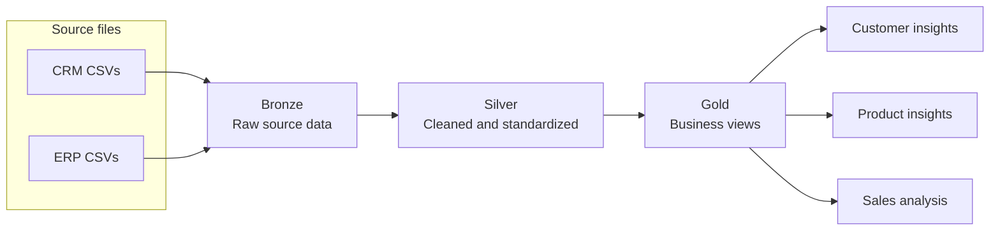
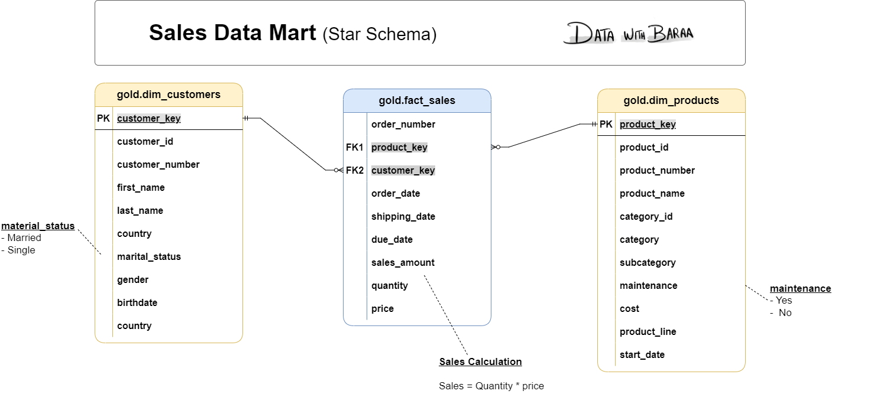

# SQL Data Warehouse Project

<p align="center">
  <strong>A layered SQL Server warehouse for integrating CRM and ERP sales data.</strong><br>
  Load raw data, clean and standardize it, then explore business-ready customer, product, and sales views.
</p>

<p align="center">
  
  
  
</p>

## At a glance

This project builds a modern data warehouse in SQL Server from sample CSV data supplied by two source systems: **CRM** and **ERP**. Data moves through Bronze, Silver, and Gold layers, with cleansing and integration in the Silver layer and reporting views in the Gold layer.



## Data model

The Gold layer exposes a simple star-schema style model for analytics:

| View | What it contains |
| --- | --- |
| `gold.dim_customers` | Customer details enriched with demographic and location data |
| `gold.dim_products` | Product attributes and category information |
| `gold.fact_sales` | Sales transactions linked to customers and products |



## Repository structure

```text
.
├── datasets/
│   ├── source_crm/       # CRM customer, product, and sales CSVs
│   └── source_erp/       # ERP customer, location, and product category CSVs
├── docs/                 # Requirements, data catalog, diagrams, and project notes
├── scripts/
│   ├── bronze/           # Raw layer table definitions and load procedure
│   ├── silver/           # Clean layer table definitions and load procedure
│   ├── gold/             # Analytics views
│   └── init_database.sql # Database and schema setup
└── tests/                # Bronze/silver and Gold quality checks
```

## Get started

### Prerequisites

- SQL Server and a SQL client such as SQL Server Management Studio (SSMS)
- Permission to create databases, schemas, and bulk load data
- This repository's CSV files accessible to the SQL Server machine or service account

### Run the pipeline

1. Clone or download the repository.
2. Open `scripts/init_database.sql` in SSMS and run it to create the `DataWarehouse` database and its schemas.
3. Run the table scripts in `scripts/bronze/ddl_bronze.sql` and `scripts/silver/ddl_silver.sql`.
4. In `scripts/bronze/proc_load_bronze.sql`, update each `BULK INSERT` file path to the location where you saved this repository's `datasets` folder. SQL Server must be able to access those paths.
5. Run the procedure scripts `scripts/bronze/proc_load_bronze.sql` and `scripts/silver/proc_load_silver.sql`, then load the layers:

   ```sql
   EXEC bronze.load_bronze;
   EXEC silver.load_silver;
   ```

6. Run `scripts/gold/ddl_gold.sql` to create the Gold views, then query them. For example:

   ```sql
   SELECT TOP (10) * FROM gold.dim_customers;
   SELECT TOP (10) * FROM gold.dim_products;
   SELECT TOP (10) * FROM gold.fact_sales;
   ```

> **Caution:** `scripts/init_database.sql` drops and recreates `DataWarehouse` if it already exists. Running it deletes the existing database and its data.

### Database setup SQL

The initialization script creates the database and the three warehouse schemas:

```sql
USE master;
GO

IF EXISTS (
    SELECT 1
    FROM sys.databases
    WHERE name = 'DataWarehouse'
)
BEGIN
    ALTER DATABASE DataWarehouse
    SET SINGLE_USER WITH ROLLBACK IMMEDIATE;

    DROP DATABASE DataWarehouse;
END;
GO

CREATE DATABASE DataWarehouse;
GO

USE DataWarehouse;
GO

CREATE SCHEMA bronze;
GO

CREATE SCHEMA silver;
GO

CREATE SCHEMA gold;
GO
```

## Documentation

- [Project requirements](docs/requirements.md)
- [Gold layer data catalog](docs/data_catalog.md)
- [Naming conventions](docs/naming_conventions.md)
- [Data architecture](docs/data_architecture.png) · [Data flow](docs/data_flow.png) · [Data integration](docs/data_integration.png)
- [Project notes and sketches](docs/Project_Notes_Sketches.pdf)

## Quality checks

SQL checks are in the [`tests/`](tests/) directory:

- [`quality_checks_silver.sql`](tests/quality_checks_silver.sql)
- [`quality_checks_gold.sql`](tests/quality_checks_gold.sql)

## Scope

The warehouse consolidates the latest available dataset; historical tracking is outside the current project scope. The accompanying analytics focus on customer behavior, product performance, and sales trends.

---

<p align="center">Built with SQL Server · T-SQL · CSV</p>
